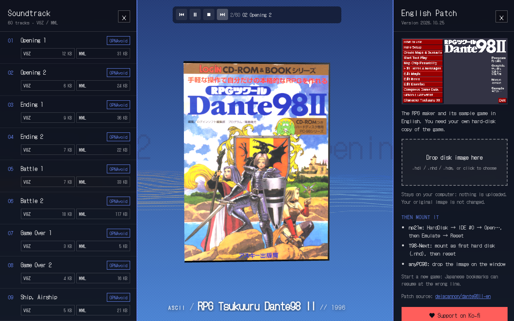

# Dante98 II EN

English translation patch for **RPG Tsukuuru Dante98 II** (ASCII, 1996, PC-98), the RPG maker and its sample game.

**[3D viewer](https://delacannon.github.io/dante98II-en/3d/)** · **[Patch page](https://delacannon.github.io/dante98II-en/)**



## Patch it

Open the [patch page](https://delacannon.github.io/dante98II-en/) or the 3D viewer and drop your own `.hdi` / `.nhd`. A patched copy is saved. Nothing is uploaded and your original is not changed.

Or from a terminal (Node 18+):

```sh
node apply.mjs Dante98II.hdi
```

The `.bps` files in `src/` also work with Flips or any other BPS patcher. The patch contains no game data: you need your own copy of the game.

## 3D viewer

3D box, soundtrack player with 60 tracks (VGZ and MML downloads, each one opens in OPNAvoid) and the patcher. Source in `viewer/`, built site in `3d/`.
